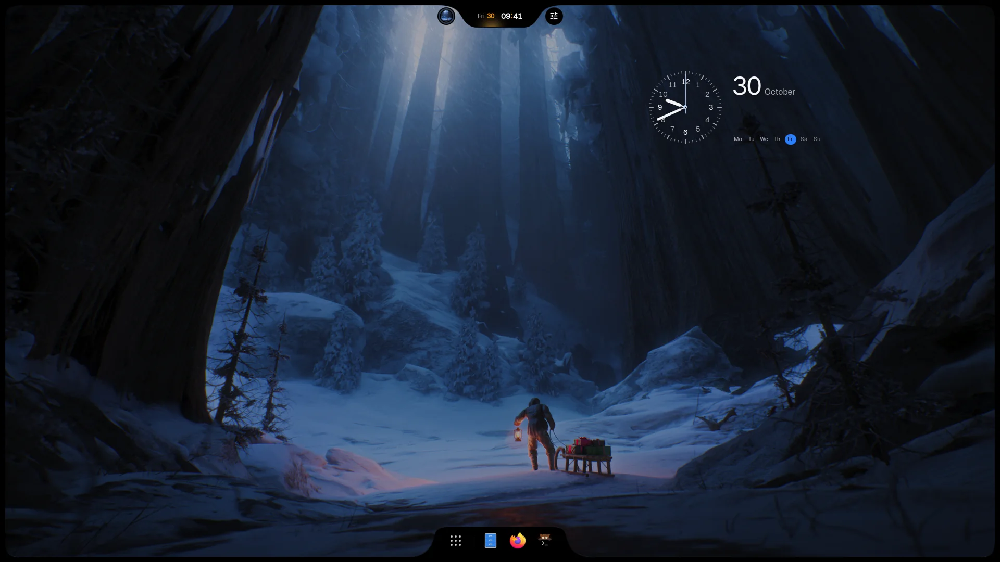
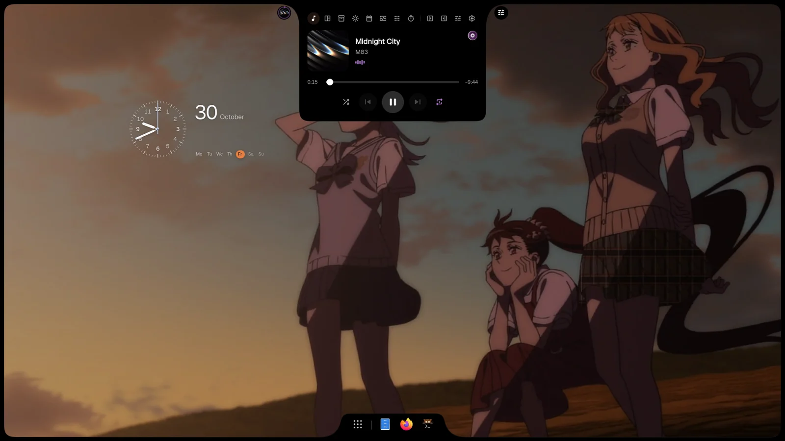
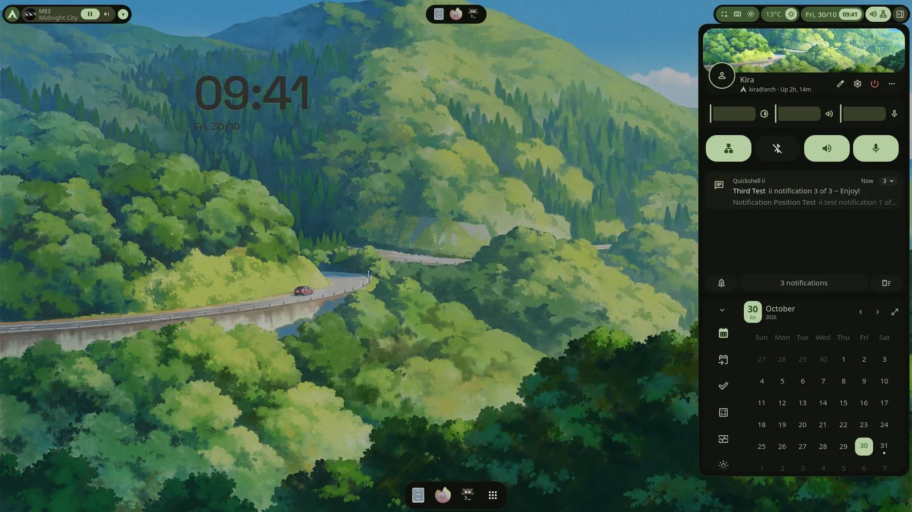
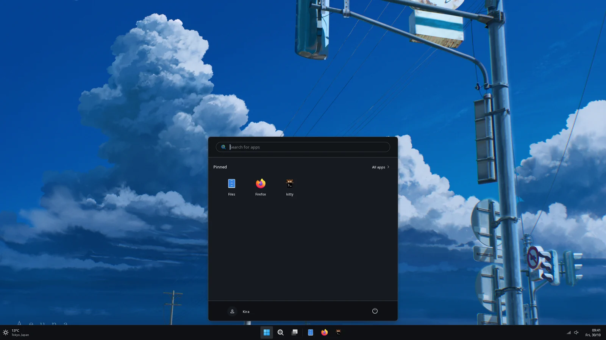

<p align="center">
  
</p>

<p align="center">
  <picture>
    <source media="(prefers-color-scheme: light)" srcset="../images/readme/mark-light.svg">
    
  </picture>
</p>

<h1 align="center">iNiR</h1>

<p align="center">
  صدفة سطح مكتب كاملة لـ <a href="https://github.com/YaLTeR/niri">Niri</a> و <a href="https://github.com/noctalia-dev/umbriel">Umbriel</a>. اختر عائلة، واجعلها على ذوقك، وحافظ على تحديثها بأمر واحد.
</p>

<p align="center">
  <a href="https://github.com/snowarch/iNiR/releases/latest"></a>
  <a href="https://github.com/snowarch/iNiR/stargazers"></a>
  <a href="https://discord.gg/pAPTfAhZUJ"></a>
  <a href="../../LICENSE"></a>
</p>

<p align="center">
  <a href="https://inir.space">inir.space</a> ·
  <a href="https://inir.space/docs/install/">التثبيت</a> ·
  <a href="https://inir.space/docs">الوثائق</a> ·
  <a href="https://inir.space/hub">Hub</a> ·
  <a href="https://inir.space/changelog">سجل التغييرات</a> ·
  <a href="https://discord.gg/pAPTfAhZUJ">Discord</a>
</p>

<p align="center">
  <sub>
    <a href="../../README.md">English</a> · <a href="README.es.md">Español</a> · <a href="README.ru.md">Русский</a> · <a href="README.zh.md">中文</a> · <a href="README.ja.md">日本語</a> · <a href="README.pt.md">Português</a> · <a href="README.fr.md">Français</a> · <a href="README.de.md">Deutsch</a> · <a href="README.ko.md">한국어</a> · <a href="README.hi.md">हिन्दी</a> · <a href="README.ar.md">العربية</a> · <a href="README.it.md">Italiano</a>
  </sub>
</p>

## العائلات

<p align="center"><br><sub><b>iRiS</b> · Island واحدة على أي حافة تتحول إلى ما تفتحه، ومعها الرصيف (dock)</sub></p>

<table>
<tr>
<td width="50%" valign="top"><br><sub><b>Material</b> · شريط على أي حافة، وأشرطة جانبية، ونظرة عامة، وأنماط عامة</sub></td>
<td width="50%" valign="top"><br><sub><b>Waffle</b> · شريط مهام ومركز إجراءات على طراز Windows 11</sub></td>
</tr>
</table>

يتم التبديل بينها عبر `Super+Shift+W`. المزيد من المظاهر والأدوات والسمات وتطبيقات الويب في [hub](https://inir.space/hub).

## التثبيت

```bash
git clone https://github.com/snowarch/inir.git
cd inir
./setup install
```

Arch، Fedora، Debian، Ubuntu، Void و NixOS. يوضح [دليل التثبيت](https://inir.space/docs/install/) ما يحتاجه كل منها. يعمل على Niri وعلى Umbriel: تشرح صفحة [المُركِّبات](https://inir.space/docs/compositors/) كيفية إضافة Umbriel.

## التحديث

```bash
inir update
```

تبقى إعداداتك وتعديلاتك كما هي. إذا لم يبدأ الإصدار الجديد، يعيد التحديث الإصدار الذي كان لديك.

## كيف بُني

iNiR هو الأساس مع الأجزاء المحيطة به، وكل جزء في مستودعه الخاص. لا يُجمَّع شيء على جهازك: يجلب setup و
`inir update` كل جزء جاهزًا مبنيًا مسبقًا، ويتحقق منه باستخدام sha256.

| المستودع | المحتوى | الأحدث |
|---|---|---|
| **iNiR** (هذا المستودع) | الأساس: الخدمات، والإعدادات، و Settings، ومعالج الترحيب، و setup والتحديث، ومضيف الإضافات |  |
| [inir-hub](https://github.com/snowarch/inir-hub) | كل الإضافات: العائلات الثلاث، والمكونات، والسمات، والأدوات، وتطبيقات الويب | [inir.space/hub](https://inir.space/hub) |
| [qs-rs](https://github.com/snowarch/qs-rs) | بيئة التشغيل: Quickshell مُعاد كتابته بلغة Rust، مع Qt الخاص به |  |
| [inir-accel](https://github.com/snowarch/inir-accel) | ما تشغّله الصدفة في الخلفية، بلغة Rust: الألوان، والصور المصغّرة، والمستشعرات، والبحث |  |
| [inir-cli](https://github.com/snowarch/inir-cli) | أمر `inir`: IPC، والتشخيص، والتحديث، `inir hub` |  |
| [inir-site](https://github.com/snowarch/inir-site) | [inir.space](https://inir.space): الموقع، والوثائق، فهرس hub | |
| [iNiR-Walls](https://github.com/snowarch/iNiR-Walls)، [inir-mascot](https://github.com/snowarch/inir-mascot) | حزمة الخلفيات، ورسومات Kira، وكلاهما اختياري في setup | |

يحتوي [Architecture](../ARCHITECTURE_OVERVIEW.md) على الخريطة الكاملة. لإضافة أي شيء، اجعله إضافةً:
[دليل inir-hub](https://github.com/snowarch/inir-hub/blob/main/CONTRIBUTING.md). لتغيير الأساس:
[CONTRIBUTING](../../.github/CONTRIBUTING.md).

## الشكر والتقدير

- [end-4](https://github.com/end-4/dots-hyprland): illogical-impulse، وهي إعدادات Hyprland التي بدأ منها iNiR
- [Quickshell](https://quickshell.outfoxxed.me/) من تطوير outfoxxed: الإطار، والواجهة البرمجية التي يحافظ عليها qs-rs
- [Niri](https://github.com/YaLTeR/niri) من تطوير YaLTeR: المُركِّب (compositor)
- [Umbriel](https://github.com/noctalia-dev/umbriel) من فريق Noctalia: المُركِّب الآخر الذي يعمل عليه iNiR
- [Gakuseei](https://github.com/Gakuseei): [Ricelin](https://github.com/Gakuseei/Ricelin)، ومنه يأتي الشريط الكبسولي ومظهرا washi و flame
- [pctrade/end4-pC](https://github.com/pctrade/end4-pC): تفرّع (fork) فيه أفكار تستحق الأخذ بها
- كل من [ساهم](https://github.com/snowarch/iNiR/graphs/contributors) وجرّب الإصدارات على Discord

[GPL-3.0](../../LICENSE) مع الشروط الواردة في [NOTICE](../../NOTICE). حقوق النشر (C) 2025-2026 snowarch.
