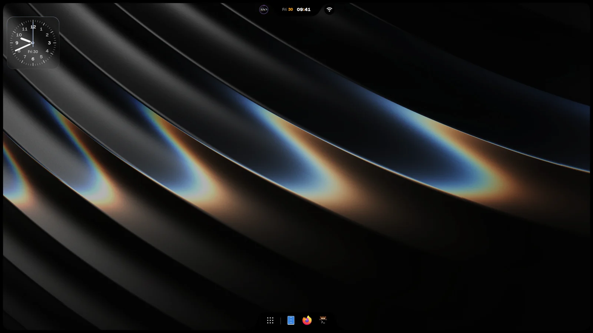

<p align="center">
  
</p>

<h1 align="center">iNiR</h1>

<p align="center">
  Una shell de escritorio completa para <a href="https://github.com/YaLTeR/niri">Niri</a>. Elige una familia, hazla tuya y mantenla al día con un solo comando.
</p>

<p align="center">
  <a href="https://inir.space">inir.space</a> ·
  <a href="https://inir.space/docs">Documentación</a> ·
  <a href="https://inir.space/hub">Hub</a> ·
  <a href="https://discord.gg/pAPTfAhZUJ">Discord</a>
</p>

<p align="center">
  <sub>
    <a href="../../README.md">English</a> · <a href="README.es.md">Español</a> · <a href="README.ru.md">Русский</a> · <a href="README.zh.md">中文</a> · <a href="README.ja.md">日本語</a> · <a href="README.pt.md">Português</a> · <a href="README.fr.md">Français</a> · <a href="README.de.md">Deutsch</a> · <a href="README.ko.md">한국어</a> · <a href="README.hi.md">हिन्दी</a> · <a href="README.ar.md">العربية</a> · <a href="README.it.md">Italiano</a>
  </sub>
</p>

## Instalación

```bash
git clone https://github.com/snowarch/inir.git
cd inir
./setup install
```

Arch, Fedora, Debian, Ubuntu, Void y NixOS. La [guía de instalación](https://inir.space/docs/install/) indica lo que necesita cada uno.

## Actualización

```bash
inir update
```

Tu configuración y tus cambios se mantienen. Si la nueva versión no arranca, la actualización restaura la versión que tenías.

## Familias

| Material | Waffle | iRiS |
|:---:|:---:|:---:|
|  |  |  |
| Una barra en cualquier borde, paneles laterales, vista general, nueve estilos globales | Una barra de tareas de Windows 11 y centro de acción | Una Island en cualquier borde que se convierte en lo que abres, más un dock |

`Super+Shift+W` cambia entre ellas. Más aspectos, widgets, temas y aplicaciones web están en el [hub](https://inir.space/hub).

## Cómo está construido

iNiR es una base y las partes que la rodean, cada una en su propio repositorio. Nada se compila en tu máquina: el setup y
`inir update` descargan cada parte ya compilada y la verifican con sha256.

| Repositorio | Qué es | Última versión |
|---|---|---|
| **iNiR** (este) | La base: servicios, configuración, Settings, el asistente de bienvenida, setup y actualización, el host de plugins |  |
| [inir-hub](https://github.com/snowarch/inir-hub) | Todos los plugins: las tres familias, componentes, temas, widgets, aplicaciones web | [inir.space/hub](https://inir.space/hub) |
| [qs-rs](https://github.com/snowarch/qs-rs) | El runtime: Quickshell reescrito en Rust, con su propio Qt |  |
| [inir-accel](https://github.com/snowarch/inir-accel) | Lo que la shell ejecuta en segundo plano, en Rust: colores, miniaturas, sensores, búsqueda |  |
| [inir-cli](https://github.com/snowarch/inir-cli) | El comando `inir`: IPC, doctor, actualización, `inir hub` |  |
| [inir-site](https://github.com/snowarch/inir-site) | [inir.space](https://inir.space): el sitio, la documentación, el catálogo del hub | |
| [iNiR-Walls](https://github.com/snowarch/iNiR-Walls), [inir-mascot](https://github.com/snowarch/inir-mascot) | El paquete de fondos de pantalla y el arte de Kira, ambos opcionales en el setup | |

[Arquitectura](../ARCHITECTURE_OVERVIEW.md) tiene el mapa completo. Para añadir algo, hazlo como plugin:
[guía de inir-hub](https://github.com/snowarch/inir-hub/blob/main/CONTRIBUTING.md). Para cambiar la base:
[CONTRIBUTING](../../.github/CONTRIBUTING.md).

## Créditos

- [end-4](https://github.com/end-4/dots-hyprland): illogical-impulse, los dotfiles de Hyprland desde los que empezó iNiR
- [Quickshell](https://quickshell.outfoxxed.me/) de outfoxxed: el framework y la API que conserva qs-rs
- [Niri](https://github.com/YaLTeR/niri) de YaLTeR: el compositor
- [Gakuseei](https://github.com/Gakuseei): [Ricelin](https://github.com/Gakuseei/Ricelin), de donde vienen la barra pill y los estilos washi y flame
- [pctrade/end4-pC](https://github.com/pctrade/end4-pC): un fork con ideas que vale la pena aprovechar
- Todas las personas que [contribuyen](https://github.com/snowarch/iNiR/graphs/contributors) y prueban en Discord

[GPL-3.0](../../LICENSE) con los términos de [NOTICE](../../NOTICE). Copyright (C) 2025-2026 snowarch.

<p align="center">
  
</p>
