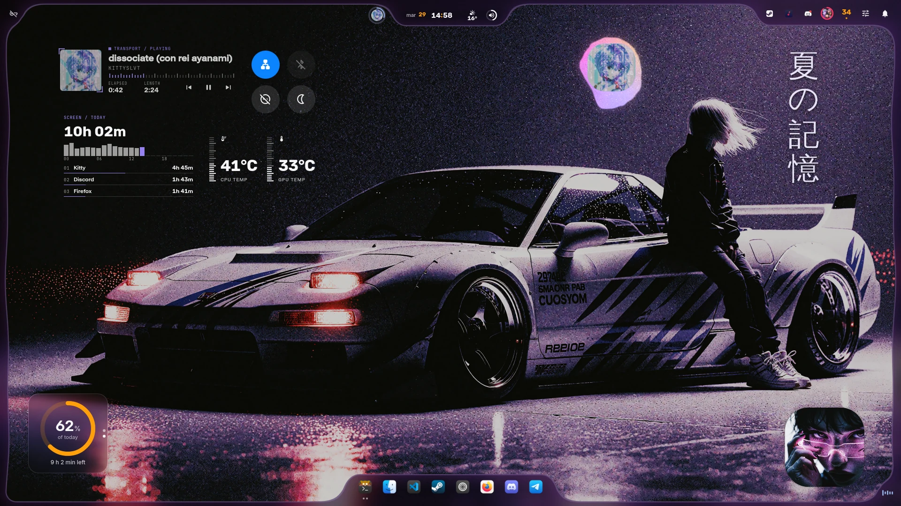
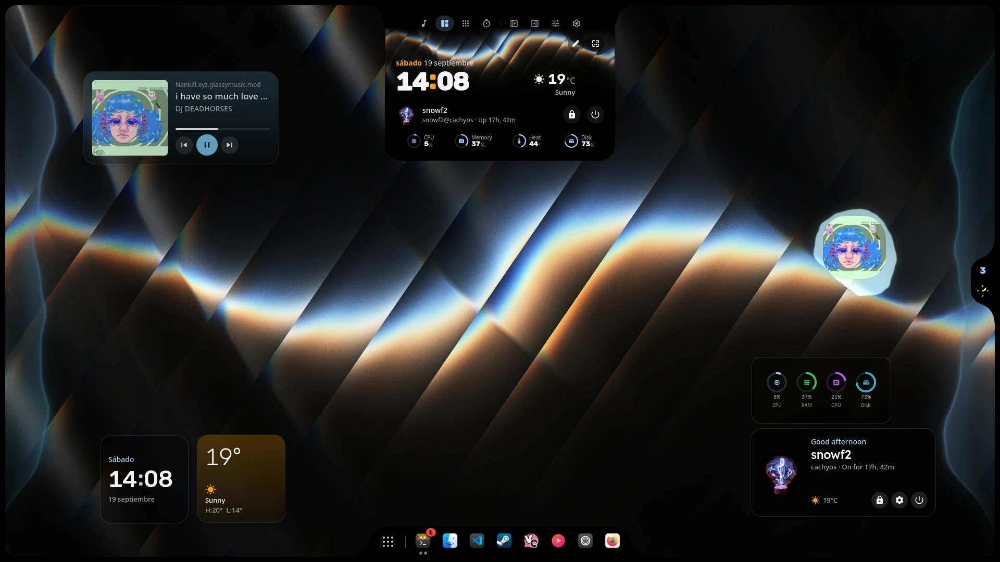
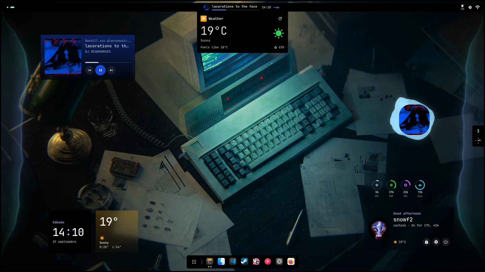

<p align="center">
  
</p>

<h1 align="center">iNiR</h1>

<p align="center">
  <sub>
    <a href="../../README.md">English</a> · <a href="README.es.md">Español</a> · <a href="README.ru.md">Русский</a> · <a href="README.zh.md">中文</a> · <a href="README.ja.md">日本語</a> · <a href="README.pt.md">Português</a> · <a href="README.fr.md">Français</a> · <a href="README.de.md">Deutsch</a> · <a href="README.ko.md">한국어</a> · <a href="README.hi.md">हिन्दी</a> · <a href="README.ar.md">العربية</a> · <a href="README.it.md">Italiano</a>
  </sub>
</p>

iNiR est un shell de bureau complet pour [Niri](https://github.com/YaLTeR/niri), construit sur [Quickshell](https://quickshell.outfoxxed.me/).

## Captures d'écran

<p align="center">
  
  
</p>

## Installation

```bash
git clone https://github.com/snowarch/inir.git
cd inir
./setup install
```

## Mise à jour

```bash
inir update
```

## Familles

Plugins du hub, installés depuis [inir.space/hub](https://inir.space/hub).

- **Material**: barre flottante, barres latérales et style Material Design
- **Waffle**: barre des tâches façon Windows 11 et centre d'action
- **iRiS**: une Île sur n'importe quel bord de l'écran qui devient ce que vous ouvrez

[Docs](https://inir.space/docs) · [Hub](https://inir.space/hub) · [Discord](https://discord.gg/pAPTfAhZUJ) · [GPL-3.0](../../LICENSE)
