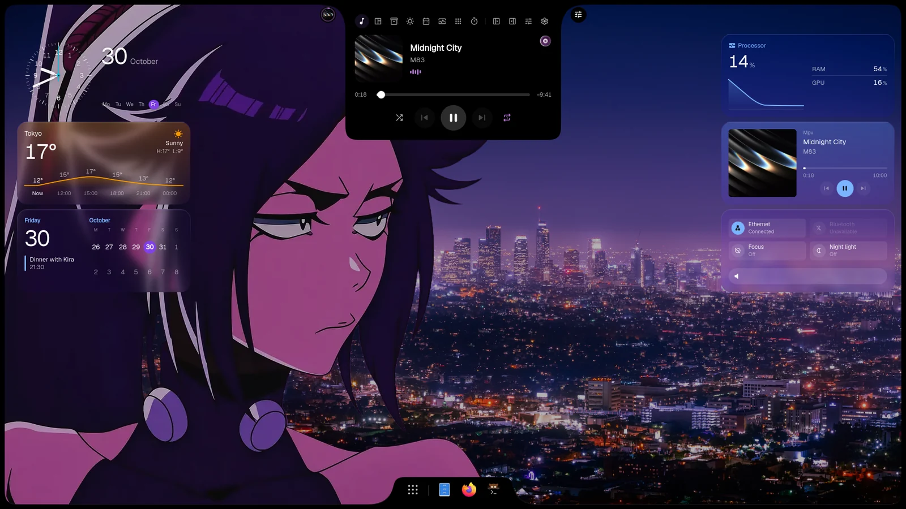
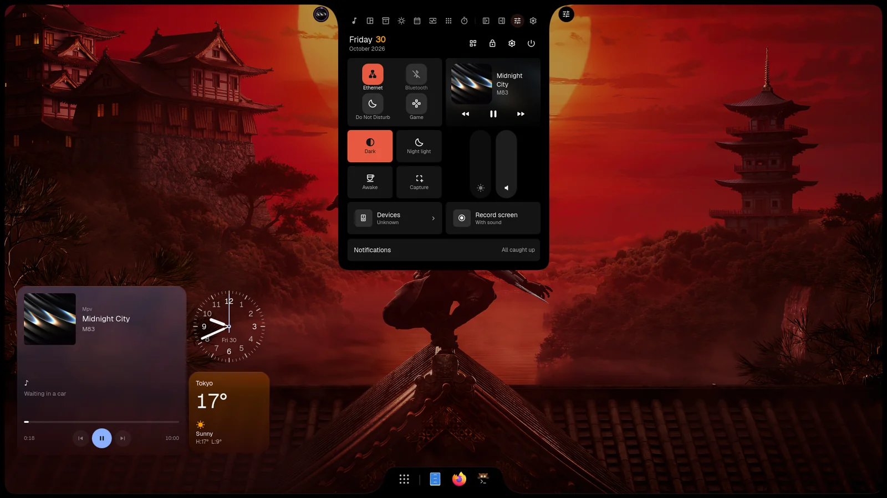
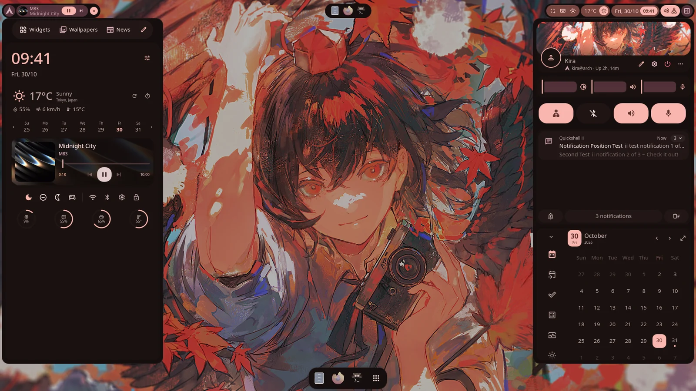
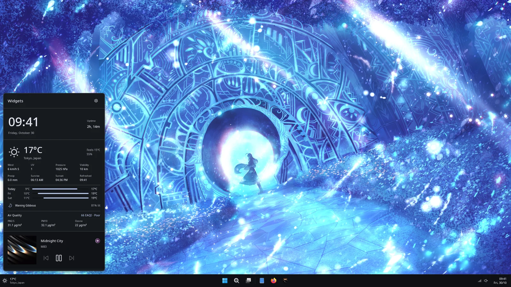
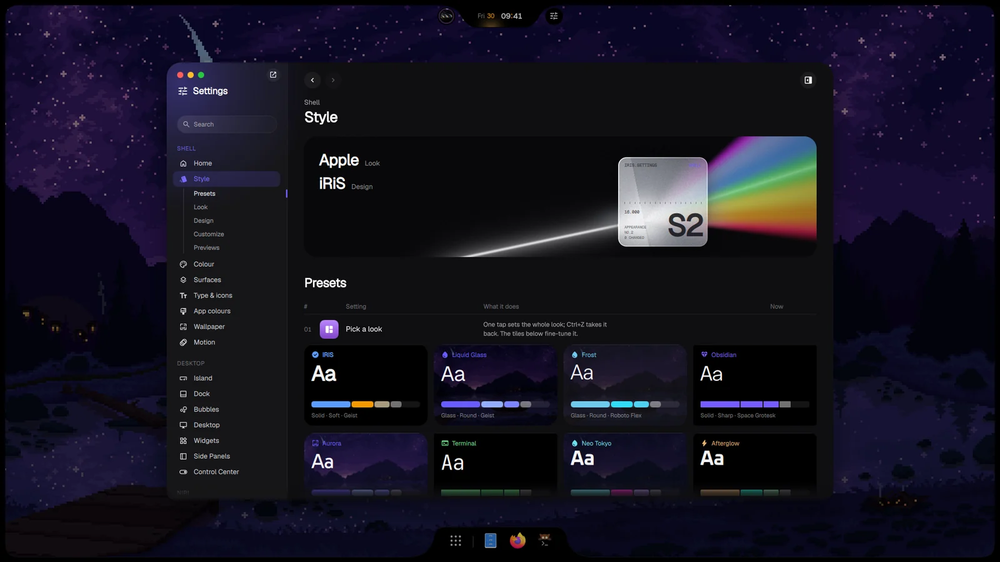
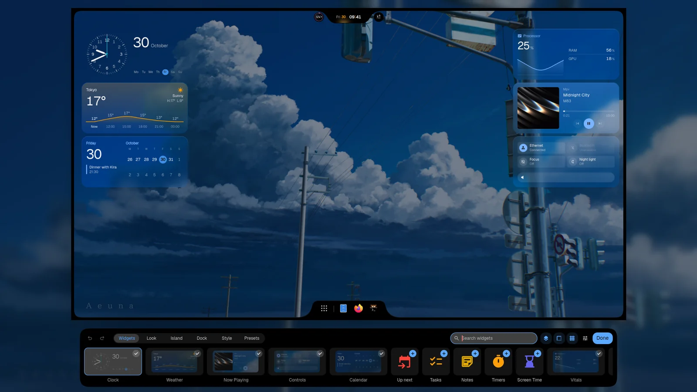
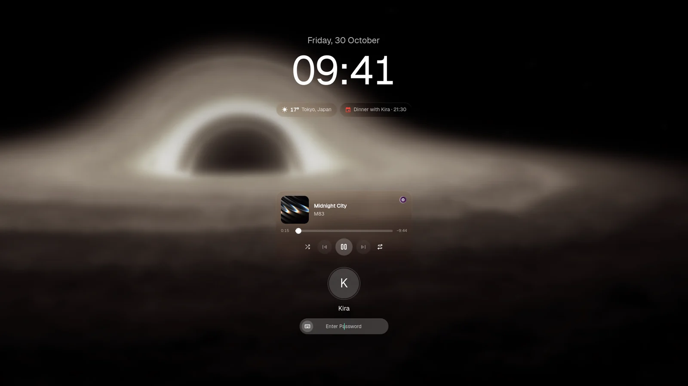

<p align="center">
  
</p>

<p align="center">
  <picture>
    <source media="(prefers-color-scheme: light)" srcset="../images/readme/mark-light.svg">
    
  </picture>
</p>

<h1 align="center">iNiR</h1>

<p align="center">
  <a href="https://github.com/YaLTeR/niri">Niri</a> と <a href="https://github.com/noctalia-dev/umbriel">Umbriel</a> 向けの完全なデスクトップシェルです。ファミリーを選び、好みに合わせて、1つのコマンドで最新の状態に保てます。
</p>

<p align="center">
  <a href="https://github.com/snowarch/iNiR/releases/latest"></a>
  <a href="https://github.com/snowarch/iNiR/stargazers"></a>
  <a href="https://discord.gg/pAPTfAhZUJ"></a>
  <a href="../../LICENSE"></a>
</p>

<p align="center">
  <a href="https://inir.space">inir.space</a> ·
  <a href="https://inir.space/docs/install/">インストール</a> ·
  <a href="https://inir.space/docs">ドキュメント</a> ·
  <a href="https://inir.space/hub">Hub</a> ·
  <a href="https://inir.space/changelog">変更履歴</a> ·
  <a href="https://discord.gg/pAPTfAhZUJ">Discord</a>
</p>

<p align="center">
  <sub>
    <a href="../../README.md">English</a> · <a href="README.es.md">Español</a> · <a href="README.ru.md">Русский</a> · <a href="README.zh.md">中文</a> · <a href="README.ja.md">日本語</a> · <a href="README.pt.md">Português</a> · <a href="README.fr.md">Français</a> · <a href="README.de.md">Deutsch</a> · <a href="README.ko.md">한국어</a> · <a href="README.hi.md">हिन्दी</a> · <a href="README.ar.md">العربية</a> · <a href="README.it.md">Italiano</a>
  </sub>
</p>

## ファミリー

<p align="center"><br><sub><b>iRiS</b> · どの端にも置ける1つの Island。開いたものに変わり、ドックも付きます</sub></p>

<table>
<tr>
<td width="50%" valign="top"><br><sub><b>Material</b> · 任意の端に置けるバー、サイドバー、オーバービュー、グローバルスタイル</sub></td>
<td width="50%" valign="top"><br><sub><b>Waffle</b> · Windows 11 のタスクバーとアクションセンター</sub></td>
</tr>
</table>

`Super+Shift+W` で切り替えられます。その他のルック、ウィジェット、テーマ、ウェブアプリは [hub](https://inir.space/hub) にあります。

<table>
<tr>
<td width="33%" valign="top"><br><sub><b>設定</b> · 各オプションを、それが変えるものの姿で</sub></td>
<td width="33%" valign="top"><br><sub><b>デスクトップ</b> · 置いて、大きさを変えて、重ねるウィジェット</sub></td>
<td width="33%" valign="top"><br><sub><b>ロック</b> · 静かに、音楽と時刻とともに</sub></td>
</tr>
</table>

## インストール

```bash
git clone https://github.com/snowarch/inir.git
cd inir
./setup install
```

Arch、Fedora、Debian、Ubuntu、Void、NixOS に対応しています。それぞれに必要なことは [インストールガイド](https://inir.space/docs/install/) にあります。Niri と Umbriel の両方で動きます。Umbriel の追加方法は [コンポジター](https://inir.space/docs/compositors/) にあります。

## アップデート

```bash
inir update
```

設定と編集内容はそのまま残ります。新しいバージョンが起動しない場合、アップデートは以前のバージョンに戻します。

## 仕組み

iNiR はベースと、その周りの各部分からできています。それぞれ独自のリポジトリにあります。お使いのマシンでは何もコンパイルされません。setup と
`inir update` が、すべての部分をビルド済みの状態で取得し、sha256 で検証します。

| リポジトリ | 内容 | 最新版 |
|---|---|---|
| **iNiR**（このリポジトリ） | ベース：サービス、設定、Settings、ようこそウィザード、setup とアップデート、プラグインホスト |  |
| [inir-hub](https://github.com/snowarch/inir-hub) | すべてのプラグイン：3つのファミリー、コンポーネント、テーマ、ウィジェット、ウェブアプリ | [inir.space/hub](https://inir.space/hub) |
| [qs-rs](https://github.com/snowarch/qs-rs) | ランタイム：Rust で書き直した Quickshell。独自の Qt を含む |  |
| [inir-accel](https://github.com/snowarch/inir-accel) | シェルがバックグラウンドで行う処理（色、サムネイル、センサー、検索）を Rust で実装 |  |
| [inir-cli](https://github.com/snowarch/inir-cli) | `inir` コマンド：IPC、診断、アップデート、`inir hub` |  |
| [inir-site](https://github.com/snowarch/inir-site) | [inir.space](https://inir.space)：サイト、ドキュメント、hub のカタログ | |
| [iNiR-Walls](https://github.com/snowarch/iNiR-Walls), [inir-mascot](https://github.com/snowarch/inir-mascot) | 壁紙パックと Kira のイラスト。どちらも setup では任意です | |

[アーキテクチャ](../ARCHITECTURE_OVERVIEW.md) に全体図があります。機能を追加するには、プラグインとして作ってください：
[inir-hub のガイド](https://github.com/snowarch/inir-hub/blob/main/CONTRIBUTING.md)。ベースを変更するには：
[CONTRIBUTING](../../.github/CONTRIBUTING.md)。

## クレジット

- [end-4](https://github.com/end-4/dots-hyprland)：illogical-impulse。iNiR が出発点とした Hyprland の dots
- [Quickshell](https://quickshell.outfoxxed.me/)、作者 outfoxxed：フレームワーク。qs-rs が維持している API
- [Niri](https://github.com/YaLTeR/niri)、作者 YaLTeR：コンポジター
- [Umbriel](https://github.com/noctalia-dev/umbriel)、Noctalia チーム：iNiR が動くもう一つのコンポジター
- [Gakuseei](https://github.com/Gakuseei)：[Ricelin](https://github.com/Gakuseei/Ricelin)。ピル型のバーと washi・flame の外観はここから来ています
- [pctrade/end4-pC](https://github.com/pctrade/end4-pC)：取り入れる価値のあるアイデアを持つフォーク
- [コントリビューター](https://github.com/snowarch/iNiR/graphs/contributors)と、Discord でテストしてくれるすべての人

[GPL-3.0](../../LICENSE) ライセンス。条件は [NOTICE](../../NOTICE) にあります。著作権 (C) 2025-2026 snowarch。
