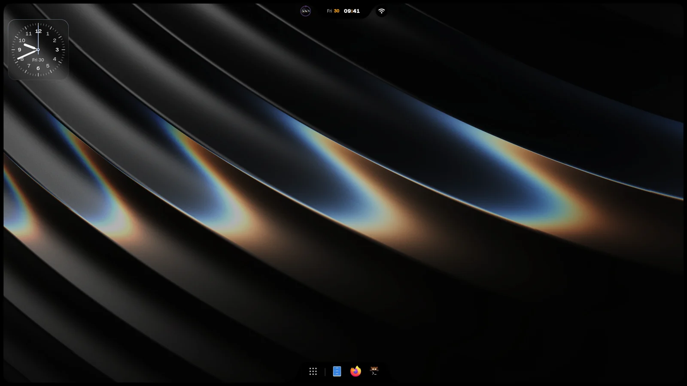

<p align="center">
  
</p>

<h1 align="center">iNiR</h1>

<p align="center">
  Полноценная оболочка рабочего стола для <a href="https://github.com/YaLTeR/niri">Niri</a>. Выберите семейство, настройте его под себя и обновляйте одной командой.
</p>

<p align="center">
  <a href="https://inir.space">inir.space</a> ·
  <a href="https://inir.space/docs">Документация</a> ·
  <a href="https://inir.space/hub">Hub</a> ·
  <a href="https://discord.gg/pAPTfAhZUJ">Discord</a>
</p>

<p align="center">
  <sub>
    <a href="../../README.md">English</a> · <a href="README.es.md">Español</a> · <a href="README.ru.md">Русский</a> · <a href="README.zh.md">中文</a> · <a href="README.ja.md">日本語</a> · <a href="README.pt.md">Português</a> · <a href="README.fr.md">Français</a> · <a href="README.de.md">Deutsch</a> · <a href="README.ko.md">한국어</a> · <a href="README.hi.md">हिन्दी</a> · <a href="README.ar.md">العربية</a> · <a href="README.it.md">Italiano</a>
  </sub>
</p>

## Установка

```bash
git clone https://github.com/snowarch/inir.git
cd inir
./setup install
```

Arch, Fedora, Debian, Ubuntu, Void и NixOS. В [руководстве по установке](https://inir.space/docs/install/) написано, что нужно каждой из них.

## Обновление

```bash
inir update
```

Ваша конфигурация и ваши правки сохраняются. Если новая версия не запускается, обновление возвращает предыдущую.

## Семейства

| Material | Waffle | iRiS |
|:---:|:---:|:---:|
|  |  |  |
| Панель у любого края, боковые панели, обзор, девять глобальных стилей | Панель задач Windows 11 и центр действий | Одна Island у любого края, которая превращается в то, что вы открываете, плюс док |

`Super+Shift+W` переключает между ними. Больше вариантов оформления, виджетов, тем и веб-приложений есть в [hub](https://inir.space/hub).

## Устройство

iNiR — это основа и части вокруг неё, каждая в своём репозитории. На вашем компьютере ничего не компилируется: setup и
`inir update` загружают каждую часть уже собранной и проверяют её по sha256.

| Репозиторий | Что это | Последняя версия |
|---|---|---|
| **iNiR** (этот) | Основа: сервисы, конфигурация, Settings, мастер приветствия, setup и обновление, хост плагинов |  |
| [inir-hub](https://github.com/snowarch/inir-hub) | Все плагины: три семейства, компоненты, темы, виджеты, веб-приложения | [inir.space/hub](https://inir.space/hub) |
| [qs-rs](https://github.com/snowarch/qs-rs) | Рантайм: Quickshell, переписанный на Rust, со своим Qt |  |
| [inir-accel](https://github.com/snowarch/inir-accel) | То, что оболочка запускает в фоне, на Rust: цвета, миниатюры, датчики, поиск |  |
| [inir-cli](https://github.com/snowarch/inir-cli) | Команда `inir`: IPC, doctor, обновление, `inir hub` |  |
| [inir-site](https://github.com/snowarch/inir-site) | [inir.space](https://inir.space): сайт, документация, каталог хаба | |
| [iNiR-Walls](https://github.com/snowarch/iNiR-Walls), [inir-mascot](https://github.com/snowarch/inir-mascot) | Пакет обоев и арт Киры, оба необязательны в setup | |

[Архитектура](../ARCHITECTURE_OVERVIEW.md) содержит всю схему. Чтобы что-то добавить, сделайте это плагином:
[руководство по inir-hub](https://github.com/snowarch/inir-hub/blob/main/CONTRIBUTING.md). Чтобы изменить основу:
[CONTRIBUTING](../../.github/CONTRIBUTING.md).

## Благодарности

- [end-4](https://github.com/end-4/dots-hyprland): illogical-impulse, дотфайлы Hyprland, с которых начался iNiR
- [Quickshell](https://quickshell.outfoxxed.me/) от outfoxxed: фреймворк и API, которое сохраняет qs-rs
- [Niri](https://github.com/YaLTeR/niri) от YaLTeR: композитор
- [Gakuseei](https://github.com/Gakuseei): [Ricelin](https://github.com/Gakuseei/Ricelin), откуда пришли панель pill и стили washi и flame
- [pctrade/end4-pC](https://github.com/pctrade/end4-pC): форк с идеями, которые стоит перенять
- Все, кто [вносит вклад](https://github.com/snowarch/iNiR/graphs/contributors) и тестирует в Discord

[GPL-3.0](../../LICENSE) с условиями из [NOTICE](../../NOTICE). Copyright (C) 2025-2026 snowarch.

<p align="center">
  
</p>
