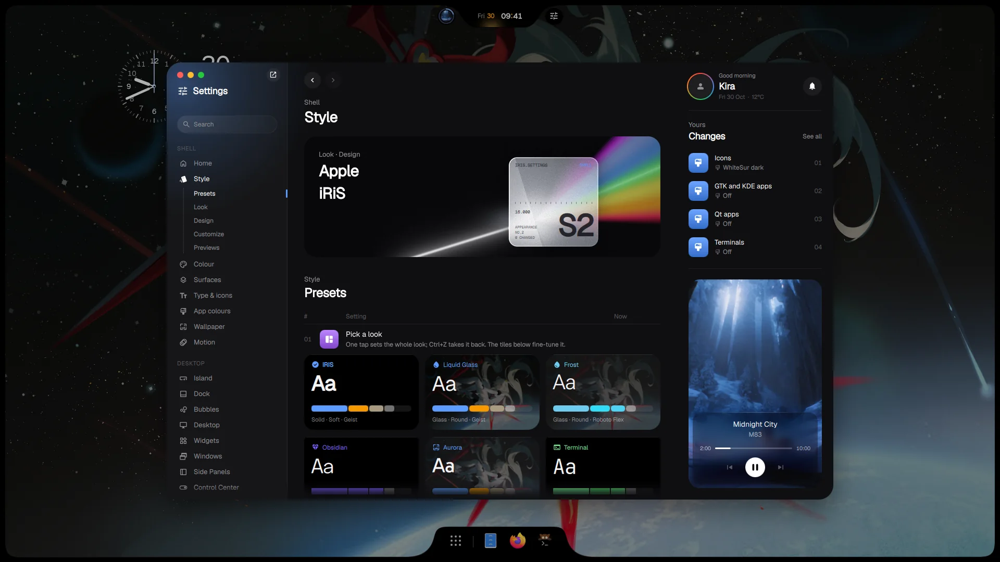
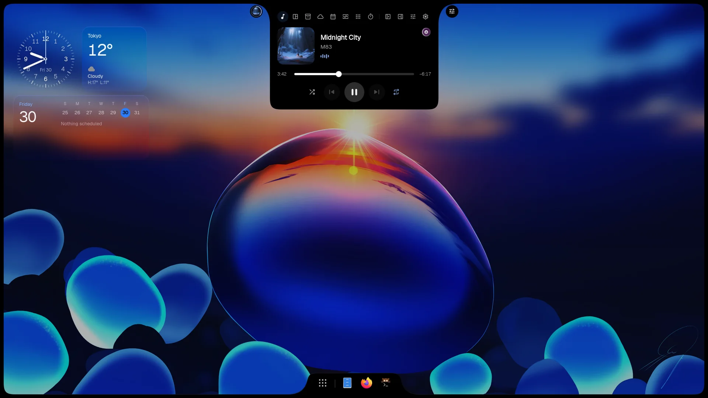
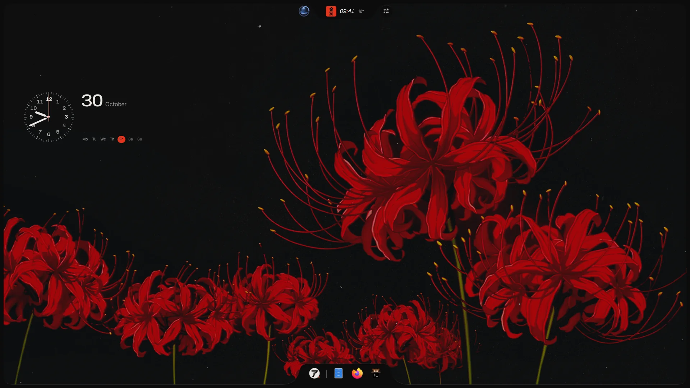
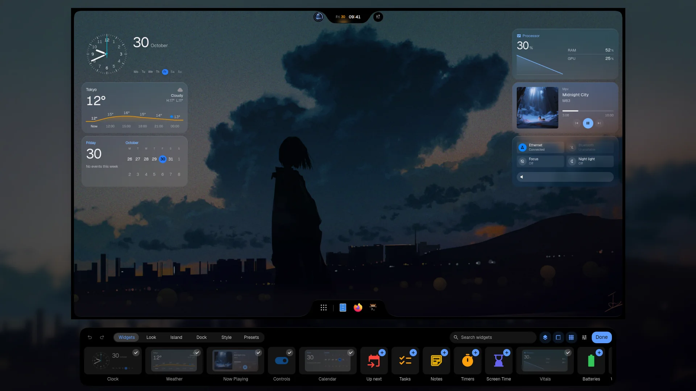
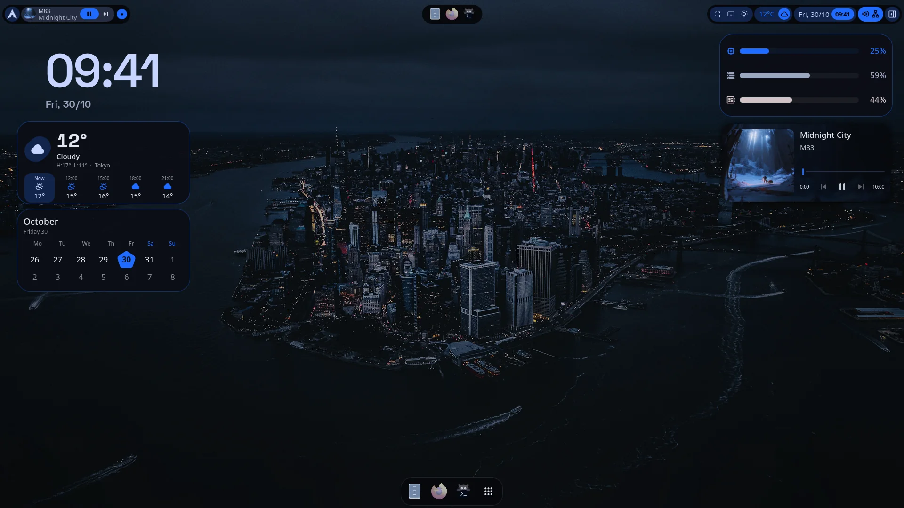
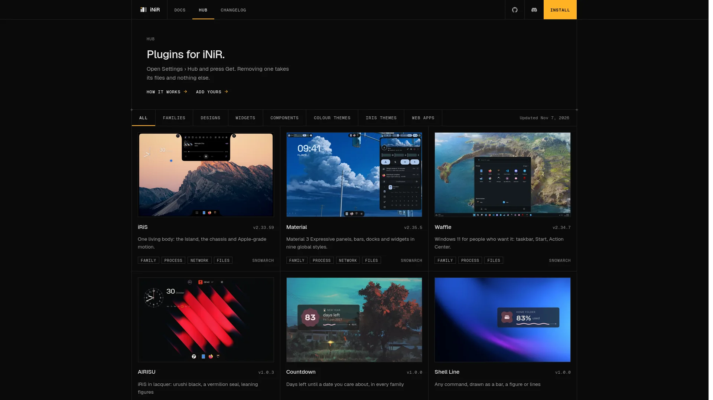
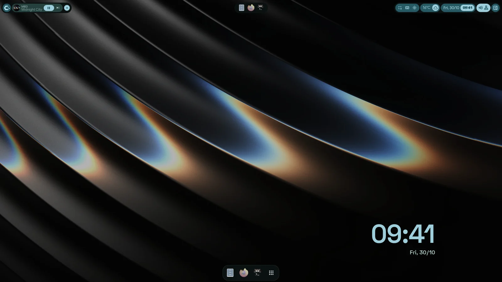
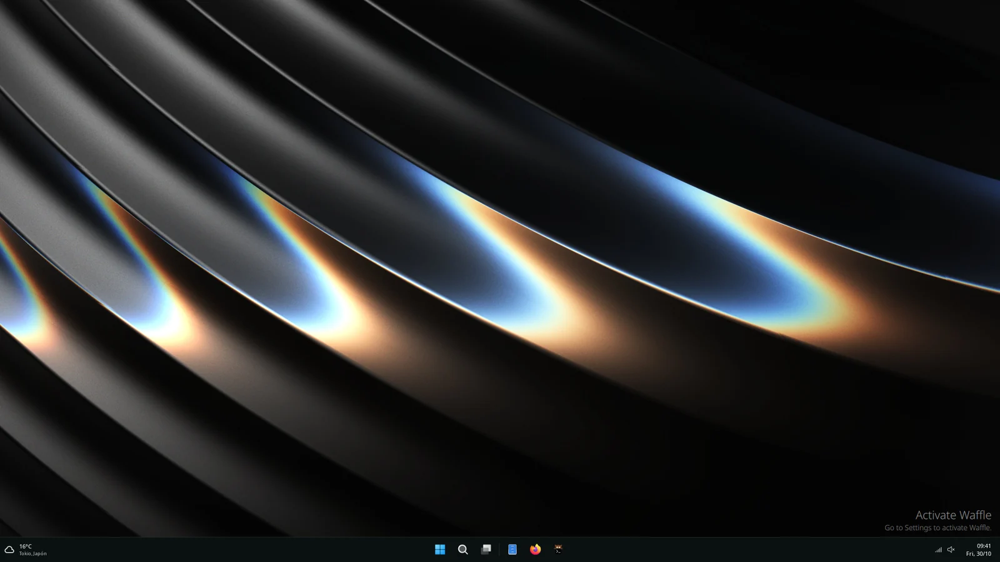
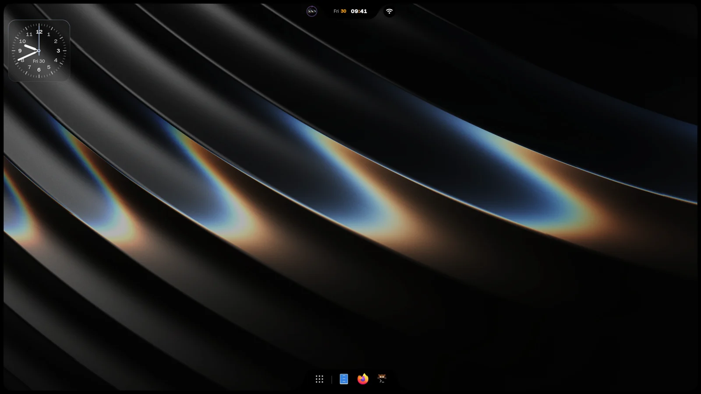

<p align="center">
  
</p>

<h1 align="center">iNiR</h1>

<p align="center">
  为 <a href="https://github.com/YaLTeR/niri">Niri</a> 打造的完整桌面外壳。选一个系列，按你的喜好定制，用一条命令保持更新。
</p>

<p align="center">
  <a href="https://github.com/snowarch/iNiR/releases/latest"></a>
  <a href="https://github.com/snowarch/iNiR/stargazers"></a>
  <a href="https://discord.gg/pAPTfAhZUJ"></a>
  <a href="../../LICENSE"></a>
</p>

<p align="center">
  <a href="https://inir.space">inir.space</a> ·
  <a href="https://inir.space/docs/install/">安装</a> ·
  <a href="https://inir.space/docs">文档</a> ·
  <a href="https://inir.space/hub">Hub</a> ·
  <a href="https://inir.space/changelog">更新日志</a> ·
  <a href="https://discord.gg/pAPTfAhZUJ">Discord</a>
</p>

<p align="center">
  <sub>
    <a href="../../README.md">English</a> · <a href="README.es.md">Español</a> · <a href="README.ru.md">Русский</a> · <a href="README.zh.md">中文</a> · <a href="README.ja.md">日本語</a> · <a href="README.pt.md">Português</a> · <a href="README.fr.md">Français</a> · <a href="README.de.md">Deutsch</a> · <a href="README.ko.md">한국어</a> · <a href="README.hi.md">हिन्दी</a> · <a href="README.ar.md">العربية</a> · <a href="README.it.md">Italiano</a>
  </sub>
</p>

## 3.0 新内容

一个小巧的基础，每个系列都是插件，拥有自己的运行时，在 [inir.space](https://inir.space) 安家，还有为 iRiS 全新打造的 Settings。一次 `inir update` 即可全部带来，并保留你的配置。[阅读完整更新日志](../../CHANGELOG.md)。

<table>
<tr>
<td width="50%" valign="top"><br><sub><b>Prism</b><br>重做的 iRiS Settings：所有选项集中一处，并实时预览它所改变的内容。</sub></td>
<td width="50%" valign="top"><br><sub><b>Island</b><br>音乐、计时器和实时活动汇于顶部的一个对象，共有十六种设计。</sub></td>
</tr>
<tr>
<td width="50%" valign="top"><br><sub><b>AIRISU</b><br>第一个 Design：在 iRiS 引擎之上拥有自己的面板、布局和风格。</sub></td>
<td width="50%" valign="top"><br><sub><b>编辑模式</b><br>拖动、调整大小并保存桌面小部件，一键切换整套桌面。</sub></td>
</tr>
<tr>
<td width="50%" valign="top"><br><sub><b>Material</b><br>同样的小部件换上 Material 自己的外观，配合重做的 Settings 与字体。</sub></td>
<td width="50%" valign="top"><br><sub><b>iNiR Hub</b><br>系列、Design、主题和小部件都是插件，可在 inir.space/hub 和 shell 内获取。</sub></td>
</tr>
</table>

## 系列

| Material | Waffle | iRiS |
|:---:|:---:|:---:|
|  |  |  |
| 可放在任意边缘的栏、侧边栏、概览，以及九种全局样式 | Windows 11 的任务栏和操作中心 | 任意边缘上的一个 Island，会变成你打开的内容，另加一个程序坞 |

`Super+Shift+W` 在它们之间切换。更多外观、小部件、主题和网页应用见 [hub](https://inir.space/hub)。

## 安装

```bash
git clone https://github.com/snowarch/inir.git
cd inir
./setup install
```

Arch、Fedora、Debian、Ubuntu、Void 和 NixOS。[安装指南](https://inir.space/docs/install/) 列出了每个系统所需的内容。

## 更新

```bash
inir update
```

你的配置和修改会保留。如果新版本无法启动，更新会恢复你原来的版本。

## 构成方式

iNiR 是一个基础，外加围绕它的各个部分，每个部分都在自己的仓库中。你的机器上不会编译任何东西：setup 和
`inir update` 会获取每个预先构建好的部分，并用 sha256 校验。

| 仓库 | 内容 | 最新版本 |
|---|---|---|
| **iNiR**（本仓库） | 基础：服务、配置、Settings、欢迎向导、setup 与更新、插件宿主 |  |
| [inir-hub](https://github.com/snowarch/inir-hub) | 所有插件：三个系列、组件、主题、小部件、网页应用 | [inir.space/hub](https://inir.space/hub) |
| [qs-rs](https://github.com/snowarch/qs-rs) | 运行时：用 Rust 重写的 Quickshell，自带 Qt |  |
| [inir-accel](https://github.com/snowarch/inir-accel) | 在后台运行的部分，用 Rust 编写：颜色、缩略图、传感器、搜索 |  |
| [inir-cli](https://github.com/snowarch/inir-cli) | `inir` 命令：IPC、诊断、更新、`inir hub` |  |
| [inir-site](https://github.com/snowarch/inir-site) | [inir.space](https://inir.space)：网站、文档、hub 目录 | |
| [iNiR-Walls](https://github.com/snowarch/iNiR-Walls), [inir-mascot](https://github.com/snowarch/inir-mascot) | 壁纸包和 Kira 的插画，两者在 setup 中都是可选的 | |

[架构](../ARCHITECTURE_OVERVIEW.md) 给出了完整的结构图。要添加功能，请把它做成插件：
[inir-hub 的指南](https://github.com/snowarch/inir-hub/blob/main/CONTRIBUTING.md)。要修改基础部分：
[CONTRIBUTING](../../.github/CONTRIBUTING.md)。

## 致谢

- [end-4](https://github.com/end-4/dots-hyprland)：illogical-impulse，iNiR 最初基于的 Hyprland 配置
- [Quickshell](https://quickshell.outfoxxed.me/)，outfoxxed 制作：框架，以及 qs-rs 所保持兼容的 API
- [Niri](https://github.com/YaLTeR/niri)，YaLTeR 制作：合成器
- [Gakuseei](https://github.com/Gakuseei)：[Ricelin](https://github.com/Gakuseei/Ricelin)，胶囊形的栏以及 washi 和 flame 外观的来源
- [pctrade/end4-pC](https://github.com/pctrade/end4-pC)：一个值得借鉴的分支
- 所有[贡献者](https://github.com/snowarch/iNiR/graphs/contributors)以及在 Discord 上参与测试的人

以 [GPL-3.0](../../LICENSE) 授权，条款见 [NOTICE](../../NOTICE)。版权所有 (C) 2025-2026 snowarch。

<p align="center">
  
</p>
